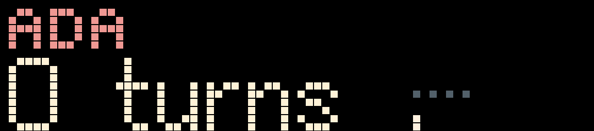
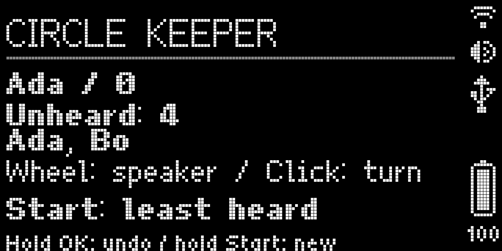

# Circle Keeper

Track speaking turns and find the people who have not yet spoken in a discussion.

A facilitator can see who has not had a turn without keeping tally marks in meeting notes. The counter follows contributions; it can suggest the next person even when several people have the same count.

Each person has a column in roster order. Its height compares their turn count with the most active speaker. A single dim pixel means they have not spoken yet. The dot below the row marks the selected person.

## Screen transitions

Count a contribution and move the selection to the person you want to invite next.



<details>

<summary>Watch the rear display</summary>



</details>

## Count contributions

1. Enter up to ten participant names separated by commas. Turn to the person speaking and click once for each contribution you want to count.
2. Watch the turn count on the front. In the example Ada goes from zero turns to two.
3. Hold the wheel if you logged the last contribution by mistake. Undo applies to the latest recorded turn regardless of which name is showing.


## Invite someone who has not spoken

1. Press **Start** to jump to the participant with the fewest turns. Someone with no turns takes priority.
2. If that person contributes, click once to record it. The clip moves from Ada to Bo with zero and records Bo’s first turn.
3. Use the rear for the number still unheard. Hold **Start** when beginning a new discussion to clear all counts.


## Example from the emulator

If Ada has two turns while Bo and Cam have none, the next suggestion is one of the two unheard participants. The tally does not measure speaking time. A short observation and a longer answer each count as one click.

## Run in the emulator

Open BUSY Bar Emulator. From this repository, run:

```sh
~/.busy-emulator/bin/busy-emulator dev --once
```

Press **Back** to exit.

The GIFs are excerpts from the emulator recording. Each LED occupies a 16 × 16 cell with a black border. The end frames pause for reading.

[Full recording](media/controls.mp4) · [Rear display](screenshots/back-1.png) · [Firmware test](EMULATOR-QA.md) · [MIT license](LICENSE)
